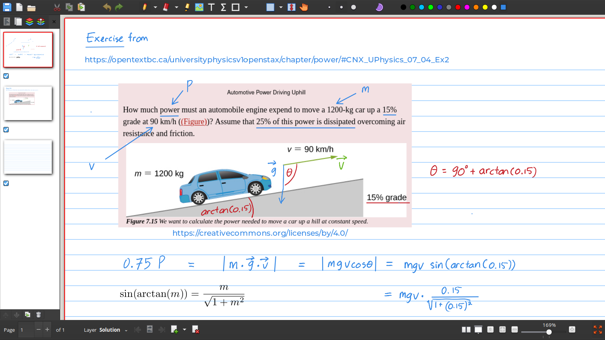
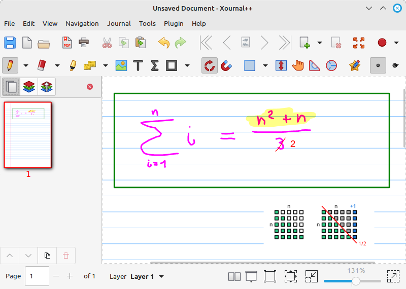

# Xournal: A Notebook That Keeps PDFs Within Reach

Read a page, mark the passage that matters, and leave enough space to explain your reasoning.
Xournal combines handwriting and PDF annotation in a notebook workflow; Xournal++ is a separate successor with additional tools and extensions.

## Make the pen comfortable before reviewing a document

Write a short sentence, underline a word, and draw a small diagram on a spare page.
Use this trial to choose a readable stroke width and a comfortable zoom.

Test light and firm pressure if your pen and driver support it.
Check the eraser button independently so that switching tools does not interrupt a longer explanation.

Give colors a consistent meaning:

- Dark ink for the main explanation.
- A contrasting color for corrections.
- A highlighter for passages to revisit.
- A separate mark for unresolved questions.

Color alone is easy to misinterpret.
Add a brief word or symbol when a comment needs to remain understandable in a grayscale printout.

For Xournal++ color references, compare [xournal.gpl](palettes/xournal.gpl) with [xournalpp.gpl](palettes/xournalpp.gpl).
The palettes contain different color selections, even though both use the GIMP palette format.

The Xournal++ [toolbar.ini.in](resources-templates/toolbar.ini.in) template lists toolbar controls and palette references.
It is useful when studying how frequently used writing tools can be grouped.

[](https://xournal-pdf.github.io/Xournal/)

## Put comments beside the argument they explain

In original Xournal, use File > Annotate PDF to create a journal with PDF pages as backgrounds.
Write observations over the relevant area while keeping the source passage readable.

A useful review separates three activities:

1. Mark the exact passage or diagram under discussion.
2. Explain the issue in your own words.
3. Record the action or question that follows.

This makes xournal pdf annotation useful for more than highlighting.
A page of colored passages becomes easier to revisit when the marks explain why those passages matter.



Leave enough space between the source text and the comment to preserve both.
For a crowded page, continue the explanation on a separate notebook page and record the source page number.

Original Xournal treats the PDF as a page background.
Its annotation tools do not rewrite the underlying paragraph into a revised PDF text document.

Use the [original Xournal manual](https://xournal.sourceforge.net/manual.html) for the legacy application's commands and behavior.
Use the [Xournal++ PDF guide](https://xournalpp.github.io/guide/pdfs/) for the successor's PDF handling.

## Preserve the notebook and its source pages

Save the editable journal before creating a copy for someone else.
Keep the PDF background available wherever the journal is opened.

For original Xournal, the normal journal extension is `.xoj`.
Choosing Attach file to the journal creates a companion PDF beside the journal rather than turning everything into one self-contained file.

For Xournal++, the normal journal extension is `.xopp`.
Its documented attach mode also uses a companion PDF and a relative reference.

A practical handoff check is to reopen the saved material from the folder you intend to share.
Confirm several pages, including one with handwriting and one with a different background.

- Keep the editable journal.
- Retain every referenced or attached background.
- Keep a separate exported PDF for ordinary reading.
- Verify the destination folder before removing an older copy.
- Test the receiving application when exchanging editable notes.

Xournal++ can read Xournal journals, but newer features may not survive an export back to the older format.
Keep the original editable version when testing compatibility.

## Choose paper that fits the explanation

Ruled pages suit prose; graph paper can help with diagrams and aligned calculations.
Choose a background because it supports the content, then check whether it remains useful at the final reading size.

For xournal notes, consistent page organization makes later review easier.
Start a new section with a clear title and leave enough room for corrections.

Xournal++ provides page-template definitions in [pagetemplates.ini.in](resources-templates/pagetemplates.ini.in).
A small Xournal++ page-template INI entry can look like this:

```ini
[reviewGraph]
name=Review Graph
format=graph
```

This illustrates the template syntax and belongs with the application's page-template configuration.
It does not configure original Xournal.

The Xournal++ ToggleGrid plugin changes the current page background and grid-snapping state.
Its [togglegrid.lua](plugins/ToggleGrid/togglegrid.lua) implements the action, and [plugin.ini](plugins/ToggleGrid/plugin.ini) supplies the plugin metadata.

A visible grid and snapping serve different purposes.
Inspect the behavior of the installed plugin before relying on either setting during precise drawing.

## Keep a long explanation editable

Place distinct kinds of annotation on separate layers when you need to hide or revise them independently.
For example, keep a worked solution apart from the question so that the question can be shown again.

Select and move complete groups of marks rather than adjusting individual strokes one by one.
After rearranging content, check that arrows still point to the intended passage.



### Xournal++ actions for extending a notebook

The SpaceForNotes plugin inserts empty pages for additional writing.
Its [main.lua](plugins/SpaceForNotes/main.lua) contains the insertion logic, while [plugin.ini](plugins/SpaceForNotes/plugin.ini) identifies the plugin entry point.

The LayerActions plugin offers operations such as adding a top layer or cloning annotation layers.
Inspect [main.lua](plugins/LayerActions/main.lua) alongside [plugin.ini](plugins/LayerActions/plugin.ini) when studying its menu actions.

Cloning onto another page can replace existing annotations.
Review the plugin's confirmation behavior and keep a saved copy before applying it to valuable notes.

### Xournal++ actions for figures

The ImageActions plugin offers operations on selected images, including rotation and trimming.
Its [main.lua](plugins/ImageActions/main.lua) defines the menu actions; [plugin.ini](plugins/ImageActions/plugin.ini) supplies the metadata.

The FitToContent plugin adjusts a page around a selection or layer.
See its [main.lua](plugins/FitToContent/main.lua) and [plugin.ini](plugins/FitToContent/plugin.ini) for the supplied implementation.

Resizing a page changes its layout.
Inspect a later PDF export before using an adjusted page in a document with a fixed paper size.

## Explain a page to someone else

A live explanation benefits from a clear current point and a predictable page order.
Remove temporary marks that obscure the argument, and check the view at the audience's reading size.

For a slide deck, decide whether notes belong to one displayed step or to the complete slide.
Repeated PDF pages representing an animation can otherwise make navigation confusing.

In Xournal++, the HighlightPosition plugin toggles a position highlight.
Its [main.lua](plugins/HighlightPosition/main.lua) registers the action, with configuration in [plugin.ini](plugins/HighlightPosition/plugin.ini).

The BeamerPresentation plugin provides navigation for related PDF slide steps.
The behavior is implemented in [main.lua](plugins/BeamerPresentation/main.lua) and described by [plugin.ini](plugins/BeamerPresentation/plugin.ini).

These tools support the presentation of notes.
They do not decide which annotations should remain in a copy sent to the audience.

## Send the right artifact to the reader

Choose the handoff format around what the recipient needs to do next.
An editable journal and a PDF serve different roles.

| Artifact | Recipient's next action | What to retain |
|---|---|---|
| Original Xournal journal | Revise compatible handwritten notes | The journal and required backgrounds |
| Xournal++ journal | Continue editing with successor features | The journal and required backgrounds |
| Exported PDF | Read, print, or discuss the annotated pages | A checked export; keep the journal separately |

A Xournal PDF export is useful for sharing a visible result without requiring the recipient to use the same notebook application.
Open the result in a PDF reader and check page order, orientation, line contrast, and the marks near page edges.

For an existing Xournal++ journal, this Bash command exports selected pages:

```bash
xournalpp seminar.xopp -p seminar-review.pdf --export-range=1-3,6
```

This is the native Xournal++ CLI, assuming `xournalpp` is available on the command path.
The journal and any required PDF background must be accessible.

The project's [export discussion](https://github.com/xournalpp/xournalpp/discussions/7043) documents the page-range syntax.
Original Xournal uses its own File > Export to PDF workflow.

The Xournal++ Export plugin adds export actions for PDF, SVG, and PNG.
Its [main.lua](plugins/Export/main.lua) constructs the export request, while [plugin.ini](plugins/Export/plugin.ini) describes the plugin.

## Give a repeated review action a name

For Xournal++ users who want a consistent correction color, a small Lua plugin can register a named menu action.
The following code selects a blue pen color without recoloring an existing selection:

```lua
function initUi()
  app.registerUi({menu="Use review blue", callback="reviewBlue"})
end
function reviewBlue()
  app.changeToolColor({color=0x2457A6, tool="PEN"})
end
```

This is plugin source that needs the usual plugin metadata and loading configuration.
It runs inside Xournal++, where the `app` API is provided.

The supplied [luapi_application.def.lua](plugins/luapi_application.def.lua) documents UI registration and tool-color options.
For a different approach, the ColorCycle plugin's [main.lua](plugins/ColorCycle/main.lua) cycles through a predefined list of colors.

When evaluating xournal open source materials, identify the application before reusing a configuration or extension.
The original [Xournal project](https://xournal.sourceforge.net/) and [Xournal++](https://xournalpp.github.io/) maintain separate codebases.

For changes to the supplied successor materials, consult [CONTRIBUTING.md](CONTRIBUTING.md).
The [LICENSE](LICENSE) file contains the supplied GPL license text.

The linked local files belong to Xournal++; the collection contains selected plugins, templates, and palettes rather than a complete application checkout.
The CLI and Lua examples are labeled for Xournal++, whose additional functions should not be assumed to exist in original Xournal.

## Related Search Terms

Xournal PDF, Xournal, xournal open source, xournal notes, xournal pdf annotation, pdf, notes, notetaking, handwriting, pen, drawing, gtk3, c-plus-plus, crossplatform, open-source
